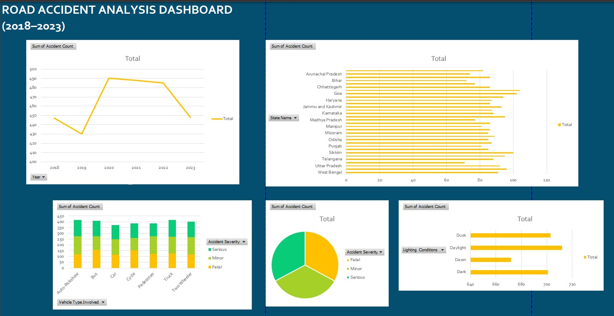

# 🚦 Road Accident Analysis Dashboard

### Every accident leaves a mark. Data helps us look closer.

An Excel-based data analytics project exploring road accidents through casualties, fatalities, geographical patterns, weather conditions, and time-based trends.

This project turns road accident data into an interactive dashboard — making it easier to explore patterns, compare categories, and look beyond the numbers.

[Explore the Dashboard](#-the-dashboard) · [Inside the Analysis](#-inside-the-analysis) · [Tools & Techniques](#-under-the-hood)

---

## 📊 The Dashboard

<p align="center">
  
</p>

<p align="center">
  <em>One dashboard. Multiple perspectives on road safety.</em>
</p>

Built in Microsoft Excel using PivotTables, PivotCharts, KPI summaries, and interactive slicers, the dashboard brings different dimensions of accident data into one analytical view.

The idea is simple: make the data easier to explore, the patterns easier to spot, and the questions easier to ask.

---

## 🧭 Inside the Analysis

Rather than looking at accidents as one overall number, this project explores several dimensions of the data.

| Area | What it explores |
|---|---|
| 🚗 Accident Overview | Overall accident patterns and key performance indicators |
| 🩹 Casualties & Fatalities | Accident severity and the human impact represented in the dataset |
| 🗺️ State-wise Analysis | Differences in recorded accident patterns across states |
| 🌦️ Weather Conditions | Accident patterns across different weather conditions |
| 🕒 Time-based Trends | Patterns across different times of day |
| 🎛️ Interactive Exploration | Filtering and comparing data through slicers, PivotTables, and charts |

These are the dimensions explored by the dashboard, not predetermined conclusions. The actual findings depend on the underlying data and the filters applied.

---

## 🔎 The Numbers Behind the View

The dashboard brings together key metrics that help frame the analysis.

- **Total Accidents** — the overall recorded accident count.
- **Total Casualties** — the number of people affected in the recorded data.
- **Total Fatalities** — recorded deaths associated with accidents.
- **Average Driver Age** — the average age represented in the dataset.

The displayed values can change with the selected filters. Rather than publishing figures that may become outdated, this README focuses on what the metrics represent.

---

## ⚙️ Under the Hood

This project uses spreadsheet-based analytical techniques to turn structured data into a visual, interactive experience.

**Tools & techniques**

- Microsoft Excel
- PivotTables and PivotCharts
- Interactive slicers for filtering
- KPI summaries
- Excel functions: `IF`, `TEXT`, and `HOUR`
- Structured references for organised calculations

The goal isn't just to make charts look good. It's about organising information so that different parts of the dataset can be explored in a meaningful way.

---

## 🗂️ What's in the Repository?

```text
Road-Accident-Analysis-Dashboard/
│
├── Dashboard.jpg
├── Road_Accident_Dashboard_Project.xlsx
└── README.md
```

| File | Purpose |
|---|---|
| `Dashboard.jpg` | Visual preview of the Excel dashboard |
| `Road_Accident_Dashboard_Project.xlsx` | Workbook containing the dashboard and analysis |
| `README.md` | Project overview, analytical scope, and documentation |

**Want to explore it yourself?**

1. Open `Dashboard.jpg` for a quick visual overview.
2. Download `Road_Accident_Dashboard_Project.xlsx` from this repository.
3. Open the workbook in Microsoft Excel to explore the dashboard and available interactive filters.

For the full interactive experience, use the workbook rather than the static image.

---

## 💡 Why This Project?

Road accidents are more than entries in a spreadsheet. Every record represents an event, and looking at the data from different angles can help us ask better questions about patterns, severity, location, and timing.

This project explores how accessible tools like Excel can support structured analysis and make information easier to interpret.

It is also a practical demonstration of data analytics fundamentals: organising data, building calculations, designing visualisations, and bringing those pieces together into an interactive dashboard.

No single chart tells the whole story. The value lies in being able to explore the data from multiple perspectives.

---

## 🔭 Where Could It Go Next?

The current project provides a foundation for further exploration. Possible future extensions include:

- 📍 Adding geographic visualisations for regional comparisons.
- 📊 Rebuilding the dashboard in Power BI.
- 🕒 Exploring more detailed regional and time-based patterns.
- 🔍 Investigating predictive analysis opportunities.
- 🔄 Exploring automated data-refresh workflows.

These are potential extensions, not features currently claimed by the project.

---

## 👩🏻‍💻 A Little About the Developer

**Sneha Singh**  
*Computer Science postgraduate | Exploring data analytics, software development, and practical technology projects.*

I enjoy working on projects that take concepts beyond theory and turn them into something people can actually explore and use. This dashboard is one such experiment in making data more accessible through visualisation.

[GitHub](https://github.com/myselfsneha) · [LinkedIn](https://www.linkedin.com/in/singh--sneha/) · [Portfolio](https://myselfsneha.github.io/sneha-portfolio/)

---

<p align="center">
  <strong>Built with Excel. Driven by data. Focused on safer roads. 🚦</strong>
</p>

<p align="center">
  <em>Looking at the numbers is one thing. Knowing what questions to ask is where the analysis begins.</em>
</p>
